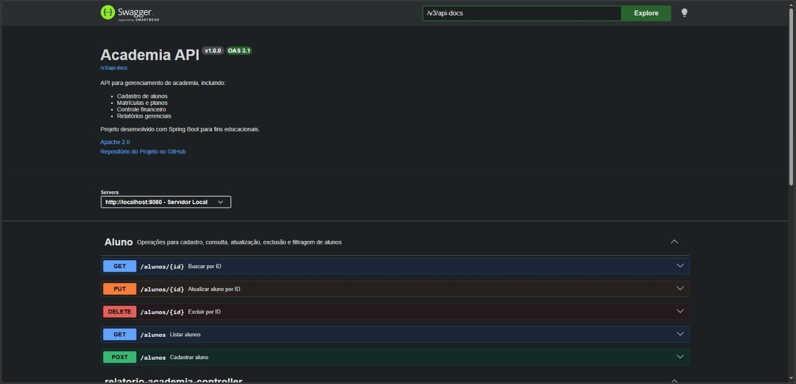

# GymSystem

API REST em Java e Spring Boot para gestão de uma academia. O projeto modela o domínio completo do negócio (alunos, planos, modalidades, matrículas, graduações, acesso por catraca e faturas de mensalidade) e já entrega o CRUD de alunos com busca filtrada, relatórios gerenciais e documentação interativa com Swagger.

## Sobre o projeto

Comecei o GymSystem para praticar back-end Java com um domínio mais realista que um CRUD simples. A ideia foi pensar primeiro em como as partes do negócio se relacionam (o schema tem 8 tabelas) e só depois nos endpoints.

**O que já está implementado**
- Modelagem de 8 entidades relacionadas com Spring Data JPA: `Aluno`, `Plano`, `Modalidade`, `Matricula`, `MatriculaModalidade`, `Graduacao`, `Assiduidade` (acesso por catraca) e `FaturaMatricula`.
- CRUD de alunos com listagem paginada e filtros opcionais, construídos com JPA Specification.
- Relatórios gerenciais com consultas SQL próprias: faturamento mensal, alunos por cidade e faturas em aberto.
- Validação dos dados de entrada com Bean Validation e regra de negócio que impede dois alunos com o mesmo e-mail.
- Tratamento de erros centralizado com `@RestControllerAdvice`, devolvendo sempre o mesmo formato de resposta.
- Documentação interativa da API com Swagger (springdoc OpenAPI).
- Banco PostgreSQL versionado com Flyway (criação do schema e dados de exemplo) e rodando em container com Docker Compose.

**Próximos passos**
- Endpoints para as demais entidades (planos, modalidades, matrículas, faturas e acessos).
- Testes unitários (JUnit e Mockito) e de integração com Testcontainers.
- Autenticação e autorização com Spring Security.
- Mover as credenciais do banco para variáveis de ambiente.

## Tecnologias

- Java 17
- Spring Boot 4 (Web MVC, Data JPA, Validation)
- PostgreSQL 15
- Flyway
- springdoc OpenAPI (Swagger UI)
- Docker e Docker Compose
- Lombok
- Maven

## Como rodar

**Pré-requisitos:** Java 17, Docker e Docker Compose.

1. Clone o repositório:
   ```bash
   git clone https://github.com/gchiancadev/gymSystem.git
   cd gymSystem
   ```

2. Suba o banco de dados:
   ```bash
   docker compose up -d
   ```

3. Rode a aplicação:
   ```bash
   ./mvnw spring-boot:run
   ```

Ao iniciar, o Flyway cria as tabelas e insere os dados de exemplo automaticamente. A API fica disponível em `http://localhost:8080`.

As credenciais do banco usadas no desenvolvimento estão no `docker-compose.yaml` e no `application.yaml`.

## Documentação da API (Swagger)

Com a aplicação rodando, abra:
```
http://localhost:8080/swagger-ui/index.html
```



Lá dá para ver todos os endpoints, os modelos de entrada e saída e testar as requisições direto pelo navegador.

## Endpoints

### Alunos

| Método | Rota | Descrição |
|--------|------|-----------|
| POST | `/alunos` | Cadastra um aluno |
| GET | `/alunos` | Lista alunos com paginação e filtros |
| GET | `/alunos/{id}` | Busca um aluno pelo id |
| PUT | `/alunos/{id}` | Atualiza um aluno |
| DELETE | `/alunos/{id}` | Remove um aluno |

A listagem aceita paginação (`page`, `size`, `sort`) e filtros opcionais por `nome`, `email` e `celular`, todos com busca parcial sem diferenciar maiúsculas de minúsculas. Exemplo:

```
GET /alunos?nome=silva&page=0&size=10
```

### Relatórios

| Método | Rota | O que retorna |
|--------|------|---------------|
| GET | `/relatorios/faturamento-mensal` | Total de faturas pagas, agrupado por mês |
| GET | `/relatorios/alunos-por-cidade` | Quantidade de alunos por cidade |
| GET | `/relatorios/faturas-em-aberto` | Faturas em aberto, com aluno e data de vencimento |

### Exemplo de cadastro

```http
POST http://localhost:8080/alunos
Content-Type: application/json

{
  "nome": "Gabriel Santos",
  "dataNascimento": "2002-08-21",
  "sexo": "M",
  "telefone": "1123456789",
  "celular": "11987654321",
  "email": "gabriel.santos@email.com",
  "observacao": "Aluno de desenvolvimento de software",
  "endereco": {
    "rua": "Rua das Palmeiras",
    "numero": "250",
    "complemento": "Casa 2",
    "bairro": "Vila Nova",
    "cidade": "Guarulhos",
    "estado": "SP",
    "cep": "07000-000"
  }
}
```

O repositório também tem o arquivo `alunos.http` com requisições prontas para testar.

### Formato de erro

Os erros de validação e de regra de negócio seguem sempre esta estrutura:

```json
{
  "timestamp": "2026-10-28T14:30:00",
  "status": 400,
  "erro": "Bad Request",
  "mensagens": ["descrição do problema"]
}
```

## Estrutura do projeto

```
src/main/java/dev/gabryel/demo
├── config         # configuração do OpenAPI/Swagger
├── controller     # endpoints REST
├── doc            # interfaces com a documentação do Swagger
├── services       # regras de negócio
├── repository     # acesso a dados (Spring Data JPA)
├── specification  # filtros dinâmicos de busca
├── projection     # modelos de retorno dos relatórios
├── domain         # entidades e enums
├── dto            # objetos de entrada e saída da API
└── exception      # tratamento centralizado de erros

src/main/resources/db/migration
├── V1__create_academia_shema.sql
├── V2__Insert_dados_iniciais.sql
└── V3__insert_dados_financeiros.sql
```

## Autor

Gabryel Chianca Lopes
[LinkedIn](https://www.linkedin.com/in/gabryelchianca/) · [GitHub](https://github.com/gchiancadev)